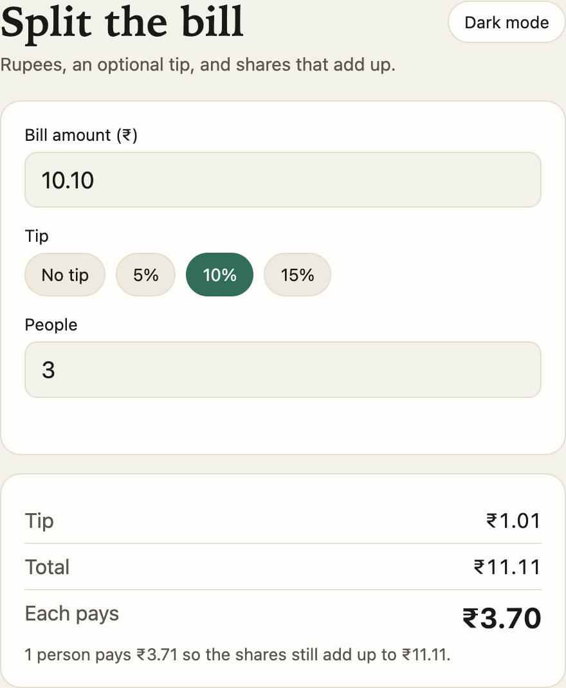

# Split the bill

A free page for splitting a restaurant bill in rupees. Pick a tip, say how many people are paying, and the shares add up to the total.



No account, no install, and no server. Open the file and it runs.

## Features

- Tip choices: none, 5%, 10%, or 15%
- Amounts stored as whole paise, so a three-way split does not lose a paisa
- A note when one or more people pay one paisa more so the shares still match the total
- Dark mode
- Amounts with more than two decimal places are rejected

## Run it

Clone the repo and open the page. There is nothing to install.

```bash
git clone https://github.com/XiaoArnav/split-the-bill.git
cd split-the-bill
open index.html
```

On Linux, use `xdg-open index.html`. On Windows, double-click `index.html`.

Try ₹10.10, 10% tip, and 3 people. The tip is ₹1.01 and the total is ₹11.11. Two people pay ₹3.70 and one pays ₹3.71.

## How the math works

The page converts the bill to paise before it calculates anything. A 10% tip is `round(paise × 10 / 100)`. Each share is the total divided by the number of people, and any leftover paise are added one at a time so the shares still sum to the total.

## Project files

| File | Purpose |
| --- | --- |
| `index.html` | The whole app: markup, styles, and script |
| `screenshot.png` | The image at the top of this page |
| `LICENSE` | MIT license |

## Contributing

Open an issue or a pull request. The app is one file, so a change should stay in `index.html` unless it is documentation.

## License

[MIT](LICENSE). Free to use, copy, and change.

## Author

[Arnav Patel](https://github.com/XiaoArnav)
